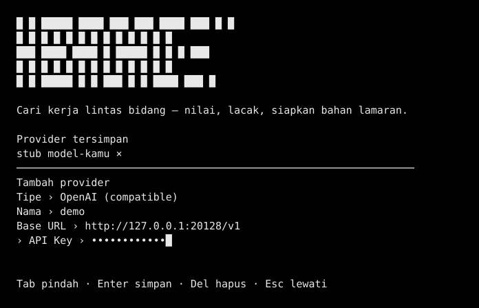
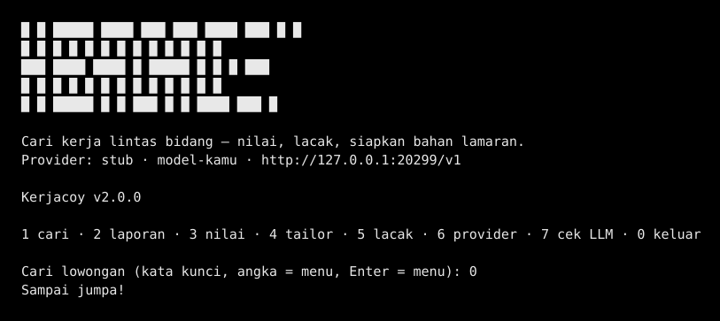

<p align="center"></p>

# Kerjacoy — Agen Pencari Kerja Lintas Bidang

**Kerjacoy** adalah agen pencari kerja: ketik apa yang kamu cari, agennya
yang bekerja — mencari lowongan lintas bidang (termasuk lowongan Indonesia),
menilai kecocokan dengan profilmu, melacak status lamaran, dan menyiapkan
bahan lamaran. Dibangun di atas [OpenCode](https://opencode.ai) (engine
v2.2.4 terpin) dengan pola yang sama seperti
[0DayExploit](https://github.com/fahmi0812/0DayExploit) — instalasi satu
baris, layar provider interaktif, home sendiri, dan updater sendiri.

Di bawah agennya ada **mesin `loker`** (Python, JobSpy + skoring transparan)
yang bisa dipakai langsung dari terminal bila kamu mau perintah cepat.

Dibangun dari pelajaran repo-repo terbaik yang sudah dianalisis:

- **JobSpy** (speedyapply/JobSpy) → mesin scraping multi-board.
- **career-ops** (career-ops-hq/career-ops) → ide penilaian transparan, pelacakan,
  dan penyesuaian CV tanpa mengarang pengalaman.
- Kekurangan yang dilengkapi di sini: **preset Indonesia terverifikasi**
  (Indeed Indonesia + LinkedIn lokasi Indonesia), **skor tanpa LLM**
  (jalan tanpa kunci API apa pun), **profil contoh lintas bidang**
  (admin, sales, customer service, logistik, umum), dan **entri manual**
  untuk portal yang tidak bisa di-scrape (JobStreet, Glints, Kalibrr).

## Instalasi

**Linux / macOS / WSL2** — satu baris:

```bash
curl -fsSL https://raw.githubusercontent.com/fahmi0812/Kerjacoy/main/install.sh | bash
```

Yang dipasang (semua di `~/.kerjacoy`, tidak menyentuh OpenCode atau
Lumitome milikmu):

1. **Engine OpenCode v2.2.4** (upstream, SHA256 terpin) di `bin/`.
2. **Node.js ≥ 22.6** (bila belum ada) di `node-v*/`.
3. **Launcher `kerjacoy` + alias `kc`** di `~/.local/bin`, dan **`loker`**
   (mesin pencari kerja Python) di venv `~/.kerjacoy/venv`.
4. **Config awal**: `AGENTS.md`, skill `kerjacoy`, agent `pemburu-kerja`,
   dan profil contoh di `~/.kerjacoy/config/` (hanya dibuat bila belum ada;
   milikmu tidak pernah ditimpa).

Jalankan lagi kapan saja untuk memperbarui; hapus dengan
`bash ~/.kerjacoy/src/install.sh --uninstall`.

**Windows** — lewat npm (butuh Node.js ≥ 22.6 dan Python 3.10+):

```powershell
npm install -g https://github.com/fahmi0812/Kerjacoy/tarball/v2.0.0
```

Mesin `loker` dipasang otomatis bila Python tersedia. Hapus dengan
`npm uninstall -g kerjacoy` lalu hapus `%USERPROFILE%\.kerjacoy`.

**Instalasi manual** (bila tidak mau pakai installer) — clone repo ini,
lalu jalankan `bash install.sh` dari root repo (langkah 1–4 di atas).
Perintah `loker` saja (tanpa agen) bisa dipasang manual:

```bash
git clone https://github.com/fahmi0812/Kerjacoy.git
cd Kerjacoy
python3 -m venv venv && source venv/bin/activate
pip install -e .
```

> Catatan instalasi: `python-jobspy` punya konflik metadata numpy dengan pip
> resolver. Jika instalasi gagal, jalankan workaround ini (sudah teruji):
>
> ```bash
> pip install --no-deps python-jobspy==1.4.1
> pip install pydantic tls-client requests markdownify regex curl_cffi
> ```

Kebutuhan: Python 3.10+, git, Node.js ≥ 22.6 (untuk agen; tidak perlu bila
hanya memakai `loker`).

## Pakai agennya (TUI)

Jalankan `kerjacoy` tanpa argumen. Bila belum ada provider, layar tambah
provider langsung terbuka — isi nama, base URL, API key (diketik tersembunyi);
koneksi dites dan daftar model diambil dari `/models`:



Lalu TUI terbuka. Contoh yang bisa kamu ketik:

```
cari kerja staff admin di Indonesia
nilai ulang hasil/staff-admin.csv dengan profil contoh-admin
siapkan bahan lamaran untuk lowongan Staff Admin di SEVIMA
tandai lowongan yang sudah saya lamar
```

Agen memakai skill `kerjacoy` (otomatis dimuat) dan agent `pemburu-kerja`
untuk pekerjaan data. Perintah `loker` dijalankan agen lewat tool `shell`,
dengan provider LLM yang sama dengan yang kamu pilih di layar provider
(wrapper mengekspornya sebagai `KERJACOY_LLM_*` untuk sesi itu).

Perbarui ke versi terbaru kapan saja (bila terpasang lewat installer):

```bash
kerjacoy update
```

Provider bisa ditambah/diubah kapan saja lewat `kerjacoy provider` (layar
penuh) atau non-interaktif:

```bash
kerjacoy connect --type openai --name stub \
  --base-url http://127.0.0.1:20128/v1 --key-stdin
kerjacoy connect --list
kerjacoy models
```

## Terminal loker (mesin CLI)

Jalankan `loker` tanpa argumen untuk membuka Terminal loker (menu interaktif
— cari, lihat hasil, tailor, lacak, setup provider):



Atau pakai perintah langsung:

```bash
# 1. Cari lowongan "staff admin" di Indonesia (Indeed ID + LinkedIn ID)
loker cari --keyword "staff admin" --lokasi Indonesia --preset indonesia \
  --jumlah 50 --jam 168 --profil ~/.kerjacoy/config/profil/contoh-admin.yaml \
  --keluaran hasil/staff-admin.csv

# 2. Lihat laporan 20 teratas (otomatis dibuat di hasil/staff-admin.md)
# 3. Tandai yang sudah dilamar
loker tandai --masukan hasil/staff-admin.csv --url "https://..." --status dilamar

# 4. Siapkan bahan lamaran untuk satu lowongan
loker tailor --masukan hasil/staff-admin.csv --url "https://..." \
  --profil ~/.kerjacoy/config/profil/contoh-admin.yaml
```

## Perintah

| Perintah | Fungsi |
|---|---|
| `kerjacoy` | Buka agen (TUI); bila belum ada provider, layar provider terbuka dulu |
| `kerjacoy provider` | Layar provider (tambah/lihat/hapus, key selalu disamarkan) |
| `kerjacoy connect` | Tambah provider LLM (URL + API key) |
| `kerjacoy update` | Perbarui Kerjacoy ke tag rilis terbaru |
| `kerjacoy run "..."` | Jalankan agen sekali jalan (lihat Keterbatasan) |
| `loker` | Buka Terminal loker (menu interaktif) |
| `loker cari` | Scrape → bersihkan → dedup → skor → simpan CSV + laporan MD |
| `loker nilai` | Skor ulang CSV yang sudah ada dengan profil lain |
| `loker tambah` | Tambah lowongan manual (mis. link JobStreet/Glints) agar tetap bisa dinilai & dilacak |
| `loker tandai` | Ubah status lowongan: baru / dilihat / dilamar / wawancara / ditolak / diterima |
| `loker tailor` | Sorotan keahlian + pengalaman relevan + draf cover letter (template, tanpa LLM) |
| `loker laporan` | Buat ulang laporan MD dari CSV |
| `loker cek-llm` | Tes koneksi ke endpoint LLM yang dikonfigurasi |
| `loker provider` | Layar provider (versi Python, bila `kerjacoy provider` tidak tersedia) |
| `loker setup` | Setup provider pertama kali (wizard, bila tidak interaktif penuh) |

> Catatan: perintah Python yang dulu bernama `kerjacoy` kini bernama
> `loker` — nama `kerjacoy` dipakai oleh agen (TUI). Alias lama `carikerja`
> tetap jalan untuk `loker`.

Opsi `cari` yang penting:

- `--keyword`: kata kunci, mis. `"staff admin"`, `"customer service"`, `"sales"`.
- `--lokasi`: mis. `Indonesia`, `Jakarta`, `Remote`, `Bandung`.
- `--preset indonesia`: Indeed Indonesia + LinkedIn Indonesia.
- `--preset global`: Indeed + LinkedIn + ZipRecruiter + Glassdoor.
- `--preset luas`: semua board JobSpy — Indeed, LinkedIn, Google Jobs, Glassdoor, ZipRecruiter, Bayt, Naukri (cakupan terluas; situs yang gagal dilewati, hasil parsial tetap dipakai).
- `--situs`: pilih manual, mis. `--situs indeed,linkedin`.
- `--negara-indeed`: mis. `Indonesia`, `USA` (khusus Indeed).
- `--jumlah`: jumlah hasil per situs. `--jam`: hanya lowongan N jam terakhir.

## LLM (opsional)

Tanpa LLM pun semua perintah di atas jalan penuh. LLM hanya menambah
penilaian kedua dan draf cover letter yang lebih luwes.

Untuk agen (`kerjacoy`), LLM dikonfigurasi lewat layar provider
(`kerjacoy provider`) — tersimpan di `~/.kerjacoy/providers.json`
(non-rahasia) + `~/.kerjacoy/credentials.json` (key, 0600). Agen memakai
provider aktif; mesin `loker` yang dipanggil agen memakai provider yang
sama (diekspor sebagai environment variable untuk sesi itu).

Untuk `loker` langsung, atur lewat environment variable (tidak pernah
disimpan di repo):

| Variable | Wajib | Keterangan |
|---|---|---|
| `KERJACOY_LLM_API_KEY` | ya | API key endpoint LLM kamu |
| `KERJACOY_LLM_BASE_URL` | tidak | Default `https://api.openai.com/v1`. Isi URL lain bila memakai endpoint yang kompatibel dengan OpenAI (mis. server/gateway sendiri) |
| `KERJACOY_LLM_MODEL` | tidak | Default `gpt-4o-mini`. Nama model apa pun yang disediakan endpoint kamu |

Pemakaian:

```bash
export KERJACOY_LLM_API_KEY="kunci-kamu"
export KERJACOY_LLM_BASE_URL="https://endpoint-kamu/v1"   # bila bukan OpenAI
export KERJACOY_LLM_MODEL="nama-model-kamu"

loker cek-llm                                  # tes koneksi dulu
loker cari --keyword "staff admin" --preset indonesia \
  --profil ~/.kerjacoy/config/profil/contoh-admin.yaml \
  --keluaran hasil/staff-admin.csv --llm
loker tailor --masukan hasil/staff-admin.csv --url "<URL lowongan>" \
  --profil ~/.kerjacoy/config/profil/contoh-admin.yaml --llm
```

Dengan `--llm`, `cari`/`nilai` menambah kolom `skor_llm` dan `alasan_llm`
di CSV; skor template tetap jadi skor utama dan penentu urutan. `tailor --llm`
memakai LLM hanya untuk menulis draf cover letter — pencocokan keahlian
tetap dari template, dan prompt melarang LLM mengarang pengalaman.
Bila LLM gagal, program lanjut dengan mode tanpa LLM.

## Profil

Profil adalah file YAML yang menjelaskan siapa pelamarnya. Setelah instalasi,
profil contoh ada di `~/.kerjacoy/config/profil/` (bisa diedit; tidak pernah
ditimpa saat update):

- `contoh-umum.yaml` — pelamar fleksibel segala bidang.
- `contoh-admin.yaml`, `contoh-sales.yaml`,
  `contoh-customer-service.yaml`, `contoh-logistik.yaml`.

Isi profil: `nama`, `ringkasan`, `keahlian`, `jabatan_diinginkan`,
`lokasi_diinginkan`, `kata_hindari`, `pengalaman`. Skor dihitung transparan:

- Judul mengandung jabatan yang diinginkan: maks 40 poin.
- Deskripsi mengandung keahlian profil: maks 30 poin.
- Lokasi cocok: 15 poin. Kebaruan lowongan: maks 15 poin.
- Mengandung kata yang dihindari (mis. "bayar di muka", "deposit"): −25 per kata.

Kolom `alasan_skor` di CSV menjelaskan kenapa sebuah lowongan dapat skor itu —
tidak ada skor misterius.

## Cara kerja (arsitektur)

```
kerjacoy (launcher) ──> core/bin/kerjacoy.mjs (wrapper Node)
   │  provider screen · config OpenCode · port service sendiri
   │  KERJACOY_HOME = ~/.kerjacoy (config/data/state/cache terisolasi)
   ├─> engine OpenCode v2.2.4 (upstream, terpin SHA256)
   │     TUI agen · skill kerjacoy · agent pemburu-kerja
   │     (AGENTS.md + skills + agent + profil di ~/.kerjacoy/config/)
   └─> mesin loker (Python, ~/.kerjacoy/venv)
         loker cari/nilai/tailor/tandai/laporan — dipanggil agen via tool shell,
         dengan provider LLM yang sama (KERJACOY_LLM_* diekspor wrapper)
```

- **Isolasi**: semua milik Kerjacoy di `~/.kerjacoy`; OpenCode dan Lumitome
  milikmu tidak disentuh (config, data, state, cache, dan port service
  masing-masing sendiri). Engine tidak auto-update.
- **Mode auto**: izin tool disetujui otomatis secara default
  (`KC_AUTO=0` untuk mematikan).
- **Engine**: default binary resmi OpenCode v2.2.4 (upstream). Build Kerjacoy
  (hanya logo TUI diganti, `engine/patches/logo.patch`) belum dirilis —
  sampai rilis `engine-2.2.4-kc.1` terbit, logo di dalam TUI masih logo
  OpenCode; logo Kerjacoy tampil di layar provider dan halaman depan.

## Keterbatasan (jujur, hasil uji langsung)

- **`kerjacoy run` belum terverifikasi di VM ini**: mode sekali jalan
  berhenti setelah init dan tidak pernah mengirim permintaan chat (perilaku
  yang sama di OpenCode 1.19.5 dan 2.2.4 di lingkungan ini). **TUI
  (`kerjacoy` tanpa argumen) terverifikasi penuh** — alur skill → shell
  (`loker nilai --llm`) → jawaban akhir jalan dan 20/20 lowongan contoh
  mendapat `skor_llm`.
- **ZipRecruiter** memblokir IP cloud (HTTP 403) — butuh proxy untuk situs itu.
- **Indeed & Glassdoor** kadang timeout dari IP datacenter; ulangi atau pakai
  koneksi rumahan.
- **JobStreet, Glints, Kalibrr** tidak bisa di-scrape langsung karena proteksi
  bot — pakai `loker tambah` untuk memasukkan linknya manual, lalu tetap bisa
  dinilai, dilacak, dan dibuatkan bahan lamarannya.
- **Terverifikasi langsung 5 Nov 2026:** Indeed Indonesia dan LinkedIn lokasi
  Indonesia mengembalikan lowongan Indonesia asli (mis. "Staff Admin" di
  Tangerang, "Secretary" di Astra International Jakarta).
- Bahan lamaran di sini berbasis template dari data profil kamu sendiri —
  tidak mengarang pengalaman. Penulisan ulang penuh oleh AI tersedia lewat
  flag `--llm` (lihat "LLM (opsional)" di atas).

## Tes

```bash
node --test tests/*.test.mjs   # tes Node (wrapper, provider, update, logo)
python3 -m pytest -q           # tes Python (mesin loker)
```

Uji langsung (smoke test) 5 Nov 2026: instalasi penuh dari `install.sh`
(engine + Node + launcher + venv loker) jalan; layar provider (Node)
menyimpan provider stub dan mendeteksi 1 model; TUI membuka dan menjalankan
alur lengkap (skill kerjacoy → `loker nilai --llm` → 20/20 `skor_llm`).

## Lisensi

MIT. Dibangun untuk membantu pencari kerja; gunakan dengan bijak dan hormati
ketentuan tiap job board. Berdiri di atas [OpenCode](https://opencode.ai)
(MIT) dan pola [0DayExploit](https://github.com/fahmi0812/0DayExploit) —
lihat `NOTICE.md`.
